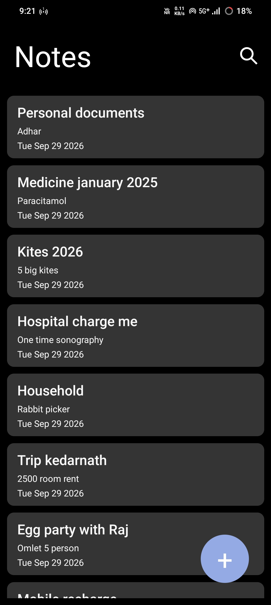
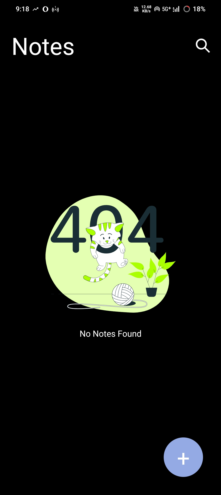
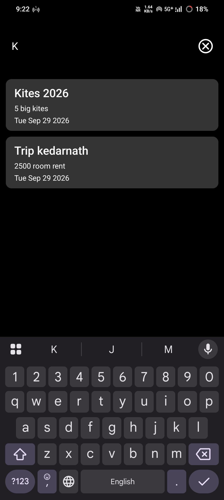
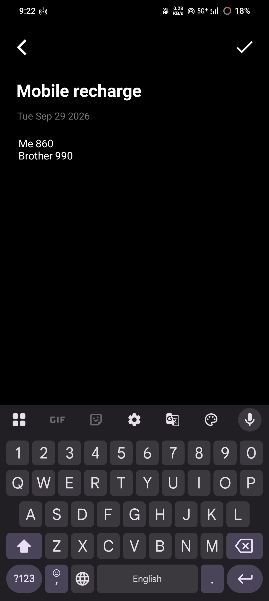
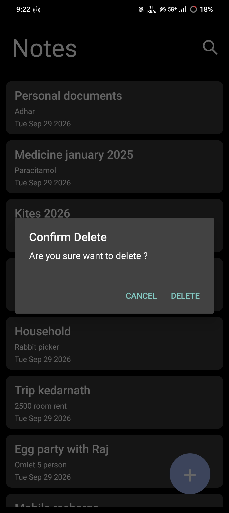

# 📝 React Native SQLite Notes App

A simple and practical **React Native Notes App** for creating, editing, viewing, searching, and deleting notes.

The app uses **SQLite for local data persistence**, so notes are stored directly on the device without requiring an online backend.

## 📱 Screenshots

| Notes List                                | Empty State                                 |
| ----------------------------------------- | ------------------------------------------- |
|  |  |

| Search Notes                                  | Add / Edit Note                                  |
| --------------------------------------------- | ------------------------------------------------ |
|  |  |

| Delete Confirmation                                         |
| ----------------------------------------------------------- |
|  |

## ✨ Features

* ➕ Create new notes
* ✏️ Edit existing notes
* 🗑️ Delete notes with confirmation
* 👀 View saved notes
* 🔍 Search notes by title
* 💾 Local data persistence using SQLite
* 📭 Animated empty state using Lottie
* 📱 Android and iOS support
* ⚡ Simple and lightweight local note management

## 🛠️ Tech Stack

* **React Native** — 0.74.2
* **JavaScript**
* **React Hooks** — `useState`, `useEffect`
* **SQLite** — `react-native-sqlite-storage`
* **Lottie** — `lottie-react-native`
* **React Native Vector Icons** — `react-native-vector-icons`

## 🗄️ Database

The application uses a local SQLite database named:

```text
MyDatabase.db
```

### Table: `notes`

| Column        | Type    | Description                     |
| ------------- | ------- | ------------------------------- |
| `id`          | INTEGER | Primary key with auto increment |
| `title`       | TEXT    | Note title                      |
| `description` | TEXT    | Note description                |
| `date`        | TEXT    | Note date                       |

The app performs the following database operations:

* **INSERT** — Create notes
* **SELECT** — Display and search notes
* **UPDATE** — Edit notes
* **DELETE** — Remove notes

All notes are stored locally on the user's device.

## 🔄 Application Flow

```text
App Launch
    ↓
Notes List
    ↓
Add / Edit Note
    ↓
Save
    ↓
Notes List
```

Users can also search notes directly from the Notes List screen.

## 📂 Project Structure

```text
NotesApp/
│
├── android/
├── ios/
├── src/
│   └── assets/
│       └── notfound.json
│
├── __tests__/
├── App.js
├── index.js
├── package.json
├── babel.config.js
├── metro.config.js
├── app.json
├── jest.config.js
└── tsconfig.json
```

The main application UI and SQLite database logic are implemented in `App.js`.

## 🚀 Getting Started

### Prerequisites

Make sure your React Native development environment is configured.

For the official React Native environment setup guide:

[React Native Environment Setup](https://reactnative.dev/docs/environment-setup?utm_source=chatgpt.com)

### 1. Clone the Repository

```bash
git clone https://github.com/jaytarsariya-dev/react-native-sqlite-notes.git
```

```bash
cd react-native-sqlite-notes
```

### 2. Install Dependencies

Using npm:

```bash
npm install
```

Or using Yarn:

```bash
yarn
```

### 3. iOS Setup

For iOS, install CocoaPods dependencies:

```bash
cd ios
pod install
cd ..
```

### 4. Start Metro

```bash
npm start
```

Or:

```bash
yarn start
```

### 5. Run on Android

Open another terminal and run:

```bash
npm run android
```

Or:

```bash
yarn android
```

### 6. Run on iOS

```bash
npm run ios
```

Or:

```bash
yarn ios
```

## 🔐 Data & Security

This application is designed as a **local SQLite notes application**.

* No Firebase backend
* No external API
* No API keys or secret tokens
* No user account system
* Notes are stored locally on the device
* No remote database is required

## 🔮 Future Improvements

Potential improvements for future versions include:

* Note categories
* Note pinning/favorites
* Rich text editing
* Sorting and filtering
* Dark mode
* Cloud backup/synchronization
* Improved database architecture and migrations

## 👨‍💻 Developer

**Jay Tarsariya**

React Native Developer | Mobile Application Developer

* React Native
* JavaScript
* TypeScript
* Firebase
* Redux
* REST APIs

## 📄 License

This project is available for learning and portfolio purposes.
